<a href="https://samadarsh.vercel.app"><picture><source media="(prefers-color-scheme: dark)" srcset="https://raw.githubusercontent.com/samadarsh/samadarsh/24be447655f03706b97df1b686ba93105569e144/hz-portfolio-dark.svg" /></picture></a><a href="https://linkedin.com/in/samadarsh14"><picture><source media="(prefers-color-scheme: dark)" srcset="https://raw.githubusercontent.com/samadarsh/samadarsh/24be447655f03706b97df1b686ba93105569e144/hz-linkedin-dark.svg" /></picture></a><a href="mailto:samadarsh14@gmail.com"><picture><source media="(prefers-color-scheme: dark)" srcset="https://raw.githubusercontent.com/samadarsh/samadarsh/24be447655f03706b97df1b686ba93105569e144/hz-email-dark.svg" /></picture></a>

<picture><source media="(prefers-color-scheme: dark)" srcset="https://raw.githubusercontent.com/samadarsh/samadarsh/24be447655f03706b97df1b686ba93105569e144/print-dark.svg" /></picture>
