<a href="https://samadarsh.vercel.app"><picture><source media="(prefers-color-scheme: dark)" srcset="https://raw.githubusercontent.com/samadarsh/samadarsh/16fc3afc47a60a8ec9e72eb29cd0dd744e4766fa/hz-portfolio-dark.svg" /></picture></a><a href="https://linkedin.com/in/samadarsh14"><picture><source media="(prefers-color-scheme: dark)" srcset="https://raw.githubusercontent.com/samadarsh/samadarsh/16fc3afc47a60a8ec9e72eb29cd0dd744e4766fa/hz-linkedin-dark.svg" /></picture></a><a href="mailto:samadarsh14@gmail.com"><picture><source media="(prefers-color-scheme: dark)" srcset="https://raw.githubusercontent.com/samadarsh/samadarsh/16fc3afc47a60a8ec9e72eb29cd0dd744e4766fa/hz-email-dark.svg" /></picture></a>

<picture><source media="(prefers-color-scheme: dark)" srcset="https://raw.githubusercontent.com/samadarsh/samadarsh/16fc3afc47a60a8ec9e72eb29cd0dd744e4766fa/print-dark.svg" /></picture>
