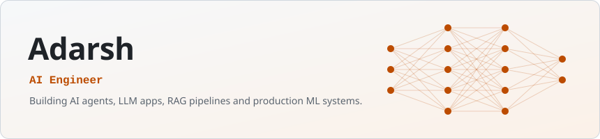

<picture><source media="(prefers-color-scheme: dark)" srcset="https://raw.githubusercontent.com/samadarsh/samadarsh/9a349f03d5cab3d69efffd4f9044991ad4c5d883/banner-dark.svg" /></picture>

<a href="https://samadarsh.vercel.app"><picture><source media="(prefers-color-scheme: dark)" srcset="https://raw.githubusercontent.com/samadarsh/samadarsh/9a349f03d5cab3d69efffd4f9044991ad4c5d883/link-portfolio-dark.svg" /></picture></a><a href="https://linkedin.com/in/samadarsh14"><picture><source media="(prefers-color-scheme: dark)" srcset="https://raw.githubusercontent.com/samadarsh/samadarsh/9a349f03d5cab3d69efffd4f9044991ad4c5d883/link-linkedin-dark.svg" /></picture></a><a href="mailto:samadarsh14@gmail.com"><picture><source media="(prefers-color-scheme: dark)" srcset="https://raw.githubusercontent.com/samadarsh/samadarsh/9a349f03d5cab3d69efffd4f9044991ad4c5d883/link-email-dark.svg" /></picture></a>

<picture><source media="(prefers-color-scheme: dark)" srcset="https://raw.githubusercontent.com/samadarsh/samadarsh/9a349f03d5cab3d69efffd4f9044991ad4c5d883/terminal-dark.svg" /></picture>

<picture><source media="(prefers-color-scheme: dark)" srcset="https://raw.githubusercontent.com/samadarsh/samadarsh/9a349f03d5cab3d69efffd4f9044991ad4c5d883/activity-dark.svg" /></picture>
